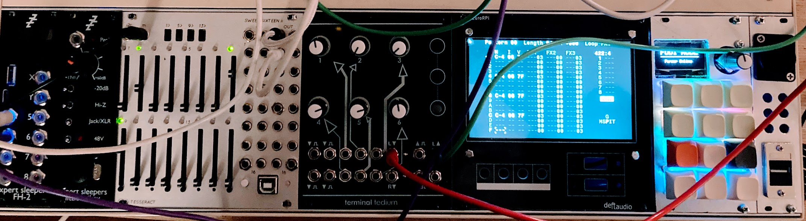

# TT MIDI Bridge - Standalone Eurorack MIDI Interface



A unified hardware interface that connects Terminal Tedium and Sweet16 MKII controllers to a Raspberry Pi running **ChooChooTracker** or **PureData** as a standalone music-making system.

This project uses a **modified 16n faderbank firmware** to enable I2C-to-MIDI conversion on the Sweet16 MKII hardware, creating a bidirectional MIDI bridge between analog controls and software sequencers/synths.

## System Architecture

```
Terminal Tedium Pots (SPI ADC)        Adafruit MacroPad
        ↓                                    ↓
   Raspberry Pi ←────────────────── USB Serial
   (ChooChooTracker/PureData)
        ↑
    MIDI Bridge
        ↑ ↓
    I2C Bus
        ↓ ↑
  Sweet16 MKII
(16n Faderbank Firmware)
        ↓
  Hardware MIDI OUT
        ↓
   Eurorack MIDI-CV modules
   (or other hardware synths)
```

## Hardware Components

### 1. Terminal Tedium Potentiometers
- **Connection**: SPI bus to Raspberry Pi
- **Interface**: MCP3208 ADC (12-bit, 8-channel)
- **Faders**: 6 analog potentiometers
- **Purpose**: Provides real-time control surface for ChooChooTracker/PureData
- **Output**: SPI → Python interface → MIDI control in software

### 2. Sweet16 MKII Faderbank
- **Firmware**: Modified 16n faderbank (I2C + hardware MIDI enabled)
- **I2C Interface**: Communicates with Raspberry Pi
- **Hardware MIDI OUT**: 3.5mm jack with direct MIDI output
- **Faders**: 16 analog faders, each 14-bit resolution
- **Purpose**: 
  - Controls ChooChooTracker/PureData via MIDI
  - Sends fader data to sequencer for live performance control
  - Hardware MIDI output for Eurorack CV conversion modules

### 3. Raspberry Pi (Controller & Sequencer Host)
- **Role**: Runs ChooChooTracker or PureData
- **Connections**:
  - I2C bus: Communicates with Sweet16 MKII
  - SPI bus: Reads Terminal Tedium pots
  - USB: Receives input from Adafruit MacroPad (optional)
- **Purpose**: Software sequencer/synth that responds to hardware controls

### 4. Adafruit MacroPad (Optional Mode Control)
- **Connection**: USB serial to Raspberry Pi
- **Hardware**: 12 programmable keys + RGB encoder + OLED display
- **Purpose**: Mode switching and display feedback
- **Modes**:
  - **TrackWerk mode**: Keyboard shortcuts for TrackWerk
  - **ChooChoo mode**: Keyboard shortcuts for ChooChooTracker
  - **PureData mode**: UDP FUDI communication for Pd patches
- **Display**: Shows current mode, key labels, and feedback from software
- **RGB Keys**: Color-coded by mode (red, green, blue per mode)

**Mode switching**: Via MIDI Program Change messages (PC 0=TrackWerk, PC 1=ChooChoo, PC 2=PureData)

## Firmware

### 16n Faderbank Firmware (Modified for I2C)
Located in `16n_firmware/16n_faderbank_firmware/`

**Key features:**
- **I2C slave mode**: Fader values readable via I2C (address `0x34`)
- **Hardware MIDI output**: Raw MIDI data sent via 3.5mm jack
- **I2C-to-MIDI bridge**: Converts I2C fader reads to MIDI CC messages
- **Responsiveness**: Overclocked Teensy 3.2 @ 120MHz
- **MIDI Clock sync**: Receives MIDI clock from DAW/sequencer

**Building and uploading:**
1. Open `16n_firmware/16n_faderbank_firmware/16n_faderbank_firmware.ino` in Arduino IDE
2. Set board to **Teensy 3.2**
3. Set USB Type to **MIDI** or **MIDI/Serial** (for debugging)
4. Set CPU Speed to **120MHz (overclock)**
5. Upload to Sweet16 MKII

### Adafruit MacroPad Firmware
Located in `macro-3/macro-3.ino`

**Key features:**
- **12 programmable keys**: Each key sends USB HID events
- **RGB encoder**: Rotary control with RGB feedback
- **OLED display**: Shows mode and key labels
- **Mode profiles**: Different key mappings for each software mode
- **UDP FUDI**: Sends data to PureData patches
- **Visual feedback**: Key colors change by mode

**Mode Profiles:**
- **TrackWerk mode**: QWERTY shortcuts for music notation entry
- **ChooChoo mode**: Navigation and playback controls
- **PureData mode**: Key presses trigger Pd messages via UDP

**Building and uploading:**
1. Open `macro-3/macro-3.ino` in Arduino IDE
2. Set board to **Adafruit RP2040 MacroPad**
3. Install required libraries: Adafruit_MacroPad, Adafruit_OLED, etc.
4. Upload to MacroPad

**Connecting to MIDI Bridge:**
The MIDI bridge automatically detects the MacroPad on its serial device and establishes communication. Mode changes are handled via MIDI Program Change messages.

## Software Setup

### Building the Bridge

```bash
# Install ALSA development libraries
sudo apt-get install libasound2-dev

# Build the bridge
g++ -std=c++11 midi_bridge.cpp -o midi_bridge -lasound
```

### Running the Bridge

```bash
./midi_bridge <14bit|7bit> [trackwerk|choochoo|puredata]
```

**Arguments:**
- `14bit` or `7bit`: Fader resolution for MIDI output
- `trackwerk`, `choochoo`, or `puredata`: Sets software mode (optional, default: choochoo)

**Examples:**
```bash
# High-precision 14-bit mode for PureData patches
./midi_bridge 14bit puredata

# Standard 7-bit mode for ChooChooTracker
./midi_bridge 7bit choochoo

# Default mode
./midi_bridge 7bit
```

### Connecting to ChooChooTracker

1. Start the MIDI bridge: `./midi_bridge 7bit choochoo`
2. Launch ChooChooTracker on the same Pi
3. Configure ChooChooTracker MIDI input:
   - Input device: Select "MIDI Bridge Hardware In"
4. Sweet16 MKII faders now control ChooChooTracker parameters

### Connecting to PureData

1. Start the MIDI bridge: `./midi_bridge 14bit puredata`
2. Launch PureData with MIDI patches
3. Create Pd objects to receive MIDI:
   ```
   [ctlin 16 1]  // Receive CC from Terminal Tedium pot 1
   [ctlin 0 1]   // Receive CC from Sweet16 fader 1
   ```
4. Terminal Tedium pots and Sweet16 faders send continuous MIDI CC data

## MIDI Control Mapping

### From Sweet16 MKII (I2C) → ALSA MIDI

**7-bit mode:**
- Fader 0-15 → MIDI CC 0-15 (values 0-127)

**14-bit mode (high precision):**
- Fader 0-15 MSB → MIDI CC 0-15 (values 0-127)
- Fader 0-15 LSB → MIDI CC 32-47 (fine resolution)

### From Terminal Tedium Pots (SPI) → ALSA MIDI

- Pot 0-5 → MIDI CC 16-21 (values 0-127)
- Used for auxiliary control (reverb, filter, effects, etc.)

### MIDI Input (From ChooChooTracker/PureData) → Sweet16 Hardware MIDI OUT

The Sweet16 MKII processes MIDI messages via I2C:
- **NoteOn/NoteOff**: Triggers hardware synths
- **Control Change (CC)**: Modulates parameters
- **Pitch Bend**: Pitch control messages
- **Program Change**: Mode switching (via MacroPad)

**I2C packet format** (from Pi to Sweet16):
```
Byte 0: Command (0x01=NoteOn, 0x02=NoteOff, 0x03=CC, 0x04=PitchBend)
Byte 1: MIDI Channel (1-16)
Byte 2: Data1 (note number or CC number, 7-bit)
Byte 3: Data2 (velocity or CC value, 7-bit)
```

## Technical Details

### I2C Protocol (Sweet16 ↔ Pi)

**Reading fader values:**
1. Write fader index (0-15) to I2C
2. Read 2 bytes (MSB first) = 14-bit fader value
3. Convert to MIDI range (0-127 for 7-bit, or MSB+LSB for 14-bit)

**Writing MIDI commands:**
- 4-byte packet contains command, channel, and two data bytes
- Faders automatically convert to hardware MIDI output

### SPI Protocol (Terminal Tedium ADC ↔ Pi)

**MCP3208 12-bit ADC reading:**
```
TX: [0x06|(ch>>2), (ch&0x03)<<6, 0x00]
RX: Extract 12-bit value from bytes 1-2
```

**Deadzone filtering:**
- Faders: Changes > 2 LSBs reported
- Pots: Changes > 8 ADC counts reported
- Prevents MIDI jitter from analog noise

### Performance

- **Poll interval**: 5ms (200Hz refresh rate)
- **I2C speed**: Standard mode (100kHz)
- **SPI speed**: 1MHz
- **Latency**: ~5-10ms round-trip
- **Fader resolution**: 14-bit (16,384 steps)
- **ADC resolution**: 12-bit (4,096 steps)

## Hardware Wiring

### I2C Connection (Sweet16 ↔ Raspberry Pi)

```
Raspberry Pi          Sweet16 MKII
GPIO2 (SDA)    ←→    I2C Data
GPIO3 (SCL)    ←→    I2C Clock
GND            ←→    GND
3.3V (optional pull-up resistors already on Sweet16)
```
``

## Software Workflow

### ChooChooTracker Setup

1. Enable I2C on Raspberry Pi: `raspi-config` → Interface Options → I2C & SPI
2. Connect Sweet16 MKII via I2C
3. Start bridge: `./midi_bridge 7bit choochoo`
4. Launch ChooChooTracker
5. Sweet16 faders now modulate ChooChooTracker parameters

### PureData Setup

1. Install PureData: `sudo apt-get install puredata`
2. Enable I2C and SPI on Raspberry Pi
3. Connect both Sweet16 (I2C) and Terminal Tedium (SPI)
4. Start bridge: `./midi_bridge 14bit puredata`
5. Create Pd MIDI receive objects for fader/pot data
6. Build custom synths and effects in Pd

### Standalone Performance

```bash
# Start bridge in background
./midi_bridge 7bit choochoo &

# Launch ChooChooTracker
choochootracker

# Now perform with hardware faders controlling software sequencer
# Terminal Tedium pots add auxiliary control (effects, filters, etc.)
```

## Troubleshooting

### I2C Issues

**"Failed to open /dev/i2c-1"**
- I2C not enabled: `raspi-config` → Interface Options → I2C
- Wrong bus: Some Pis use `/dev/i2c-0` instead of `/dev/i2c-1`

**Sweet16 not responding**
```bash
# Check I2C devices
i2cdetect -y 1

# Should show device at address 34
# If not found: check firmware upload, power, and wiring
```

### SPI Issues

**"Warning: SPI device not available"**
- SPI not enabled: `raspi-config` → Interface Options → SPI
- Terminal Tedium is optional; bridge runs without it

### MIDI Issues

**No MIDI output to hardware synths**
- Check Sweet16 MKII firmware: should be 16n firmware with I2C support
- Verify MIDI cable connection and 220Ω current-limit resistor
- Test with MIDI monitor to see if messages are sent

**Fader values not updating**
- SPI wiring check: `gpio readall` to verify pin states
- ADC address: Verify it's on I2C address 0x34

## Configuration & Customization

### Changing MIDI CC Mappings

Edit constants in `midi_bridge.cpp`:

```cpp
constexpr uint8_t TT_CC_OFFSET = 16;    // Terminal Tedium starts at CC 16
// Change to CC 32, 48, etc. for different parameter ranges
```

### Adjusting Deadzone

```cpp
constexpr int FADER_DEADZONE = 2;       // Changes > 2 LSBs
constexpr int POT_DEADZONE = 8;         // Changes > 8 ADC counts
// Increase to reduce jitter; decrease for more sensitivity
```

### MIDI Channel

```cpp
constexpr uint8_t MIDI_CHANNEL = 0;     // Channel 1 (0-indexed)
// Change to 1-15 for other channels
```


## References 

- **16n Faderbank**: https://github.com/16n-faderbank/16n
- **ChooChooTracker**: https://github.com/redoxcode/ChooChooTracker
- **PureData**: https://puredata.info/
- **Terminal Tedium**: https://github.com/mxmxmx/terminal_tedium/tree/master/software
- **Sweet16**: https://github.com/M4ngu/Sweet-Sixteen
- **Adafruit MacroPad**: https://www.adafruit.com/product/5100


